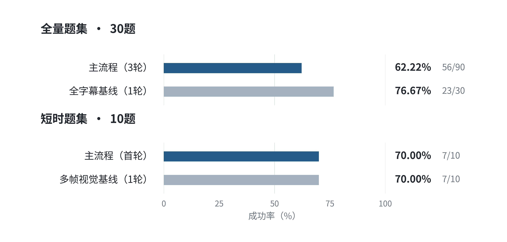
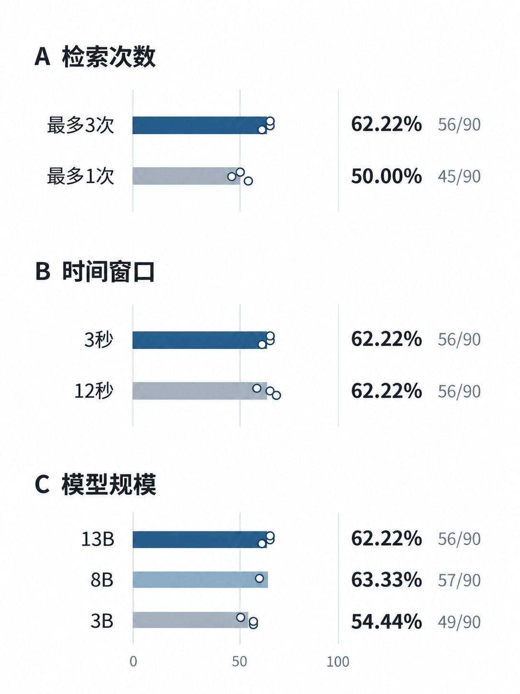
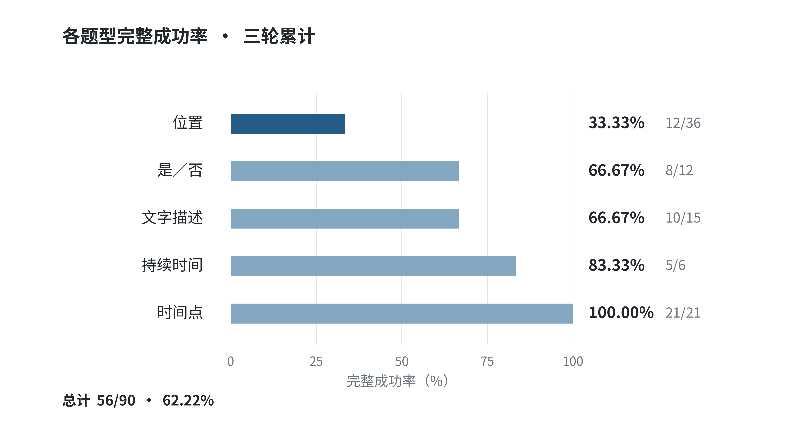
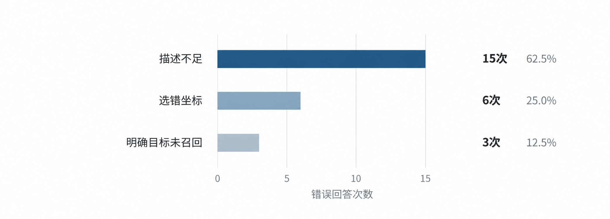

# 科研实习周报

**汇报周期：2026年10月13日**  
**研究任务：ReMEmbR 在官方 NaVQA seq0 上的 Qwen 适配复现、基线对照与消融实验**  

---

## 一、ReMEmbR 复现完成的工作

目前完成了从历史画面生成字幕、构建时空记忆、通过 Agent 多轮检索到输出答案的完整流程。实验范围限定为官方 NaVQA seq0 的全部30道问题，问答后端采用 Qwen；同时完成了主要基线和论文中的三类消融实验。

### 1. 完成 VILA 字幕生成与时空记忆构建

（1）生成视觉字幕：主流程采用 VILA1.5-13B 的 FP16 推理，以3秒画面为一个记忆段生成描述。每个记忆段6帧画面，共272个记忆段。

（2）生成向量并建立记忆库：使用 mxbai-embed-large-v1 将字幕转换为1024维向量，结合时间及机器人平均位置信息，通过 Milvus 建立可检索记忆。

### 2. 完成 Qwen Agent 多轮检索

Qwen 根据问题选择文字、时间或位置检索工具，读取返回的字幕和时空信息，再判断是否需要继续查询，最终生成位置、时间、持续时间或描述性答案。


### 3. 完成正式评测、文字评分与结果归档

位置题按三维距离误差不超过15米判定，时间点和持续时间题按绝对误差不超过2分钟判定，是／否题按参考答案核对。文字题采用LLM 判分。

| 题型 | 每轮题数 | 评分方式 |
| --- | ---: | --- |
| 位置 | 12 | 三维距离误差≤15米 |
| 时间点 | 7 | 时间误差≤2分钟 |
| 持续时间 | 2 | 时长误差≤2分钟 |
| 是／否 | 4 | 与参考答案一致 |
| 文字描述 | 5 | LLM判定 |

---

## 二、本阶段复现结果

### 1. 主流程与基线对照

全字幕基线直接将题目允许历史范围内的全部字幕交给 Qwen；多帧视觉基线则将历史图片及对应时空信息交给 Qwen-VL-Max，不经过 VILA 字幕或 Milvus 检索。两者用于比较不同的信息输入与回答方式。

| 方法 | 问题范围 | 正式轮数 | 尝试数 | 完整正确数 | 完整成功率 |
| --- | --- | ---: | ---: | ---: | ---: |
| 主流程 | 全部30题 | 3 | 90 | 55/90 | 62.22% |
| 全字幕基线 | 全部30题 | 1 | 30 | 23/30 | 76.67% |
| 多帧视觉基线 | SHORT 10题 | 1 | 10 | 7/10 | 70.00% |

在当前 seq0 和 Qwen 条件下，全字幕基线的完整成功率高于 Agent 主流程，尚未重现检索方案相对全字幕方案的性能优势。

多帧视觉基线应只与同范围的 SHORT 结果比较。视觉基线本轮为70.00%，与主流程 SHORT 第1轮的70.00%持平。

<div align="left">
  
</div>


经过分析，发现主要原因为：
```
当前记忆规模较小，尚未体现检索架构的优势。本次仅使用seq0，历史字幕规模相对有限，全字幕方法能够直接处理相应历史信息，尚未遇到明显的上下文容量限制。而检索Agent需要多次调用Qwen选择工具、执行检索并整合结果，增加了推理步骤，也引入了更多错误机会；同时只返回top5的检索结果，容易导致关键信息遗漏。因此，在当前数据规模下，全字幕方法反而表现出更高的准确率和更低的执行时延。
```

---

### 2. 复现论文的三类消融实验

完成检索次数、字幕时间窗口和字幕模型规模三类消融，对应论文表 II。全字幕与多帧视觉方法属于对照基线；统一六帧版本属于补充对齐实验。

| 消融方向 | 对照条件 | 完整正确数 | 完整成功率 | 本批观察 |
| --- | --- | ---: | ---: | --- |
| 检索次数 | 主流程，最多3轮 | 55/90 | 62.22% | 多轮检索高于单轮 |
| 检索次数 | 仅1轮检索 | 45/90 | 50.00% | 比原主流程低11.11个百分点 |
| 时间窗口 | 3秒，每组六帧 | 56/90 | 62.22% | 272条记忆 |
| 时间窗口 | 12秒，每组六帧 | 56/90 | 62.22% | 68条记忆，完整成功率持平 |
| 字幕模型规模 | 13B，3秒六帧 | 56/90 | 62.22% | 规模对照参照 |
| 字幕模型规模 | 8B，3秒六帧 | 57/90 | 63.33% | 比13B高1.11个百分点 |
| 字幕模型规模 | 3B，3秒六帧 | 49/90 | 54.44% | 比13B低7.78个百分点 |

检索次数实验以原主流程为参照；时间窗口和模型规模实验也以主流程为参照。8B和3B改变的是生成字幕的 VILA 模型，最终 Agent 问答仍采用 Qwen-plus。

12秒组记忆条数减少75%，但本批记录总 token 比3秒组增加约10.16%，未体现整体成功率或 token 节省优势。8B略高于13B的差异较小，不能认定小模型普遍更优。

<div align="left">
  
</div>

### 针对时间窗口

经数据分析，发现原因：
```
少数重复问题显著影响整体统计结果。12秒独有正确的9次全部来自同一个雕塑目标在三个历史范围下的重复提问，而3秒独有正确的9次分散于6道不同问题。由于本次仅包含seq0的30道唯一问题，同一目标的稳定识别差异会被重复计入总成绩，使整体准确率对个别场景较为敏感。因此认定该结论与原文不一致为样本量过小导致。
```
同时，在分析数据的过程中发现：
```
3秒窗口在部分目标上保留了12秒遗漏的关键细节。 例如，3秒字幕明确记录了blue recycling bin，并在黄色报警柱附近识别出POLICE HELP文字，而12秒字幕未保留这些明确描述。对应实验中，3秒窗口对回收箱定位三轮全部正确，12秒仅正确一轮。这说明较密集的视频采样在部分场景下确实能够保存更完整的目标信息，与原论文关于长窗口可能造成信息损失的解释一致。
```

### 针对模型规模

经过数据分析，发现原因：
```
单一空间目标的识别差异显著影响总体成绩。“悬挂小船雕塑”在SHORT、MEDIUM、LONG三个历史范围下分别重复测试3轮，共9次。13B在这9次中全部错误，而8B和3B均全部正确。若暂时排除该目标的9次测试，13B、8B和3B在其余81次回答中的正确数分别为56、48和40。说明8B并非整体优于13B，而是在某一特定目标上取得了明显优势，抵消了其他问题中的性能差距。
```
进一步分析后，发现：
```
不同字幕模型生成的描述也会影响后续检索效果。在小船雕塑问题中，13B字幕实际上已经包含“metal sculpture”等相关描述，但Agent未能稳定检索到参考位置附近的观测。因此，该目标的性能差异同时涉及字幕语义表达、检索候选获取和最终空间推理，而不只是视觉模型是否识别出了雕塑。
```
---

### 3. 主要题型表现

主流程的非文字成绩为46/75，即61.33%；加入文字题后完整成绩为56/90，即62.22%。各题型表现如下。

| 题型 | 三轮正确数 | 正确率 |
| --- | ---: | ---: |
| 位置 | 12/36 | 33.33% |
| 是／否 | 8/12 | 66.67% |
| 文字描述 | 10/15 | 66.67% |
| 持续时间 | 5/6 | 83.33% |
| 时间点 | 21/21 | 100.00% |


时间类问题在这批样本上表现较好，空间位置问题是主要短板。主流程的 LONG 完整成功率为16/30，即53.33%，长期历史条件下仍存在较多错误。

<div align="left">
  
</div>

在主流程的正式评测中，空间位置题是主要性能短板。原论文也存在空间定位误差较大的问题。作者也指出存在局限。

本次复现进一步通过字幕与检索记录的联合审计，将空间定位错误细分为目标描述不足、正确位置候选选择错误和明确目标未召回三类。

（1）字幕描述不足：相关视频记忆虽然存在，但VILA生成的文字没有准确说出目标是什么。

（2）位置候选选择错误：Qwen已经检索到了包含正确位置的历史记录，但面对多个候选位置时，没有选出正确答案。

（3）明确目标未被召回：VILA已经正确描述了目标，相关记录也存入了数据库，但Qwen检索时没有找到这条记录。

<div align="left">
  
</div>
