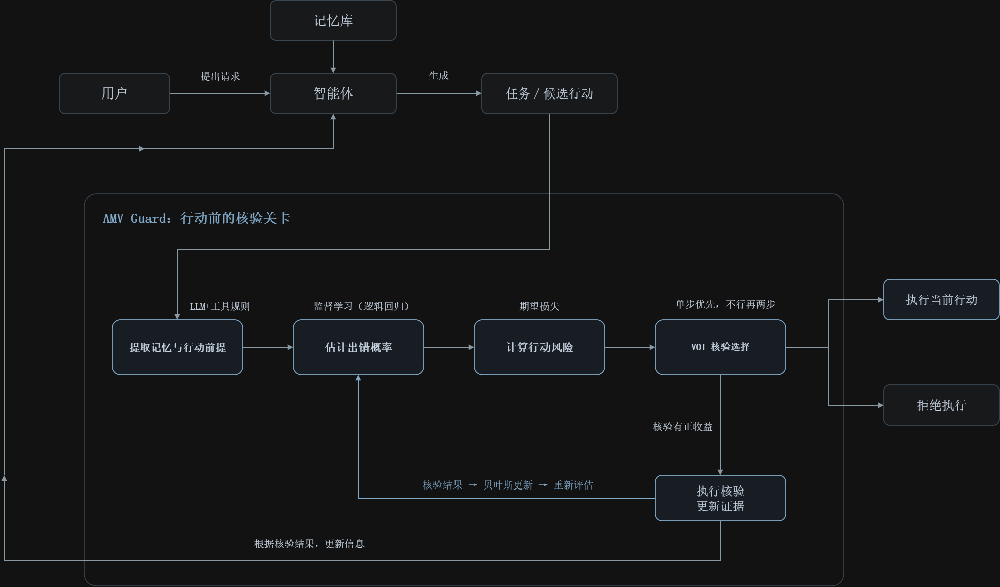

# AMV 与 Mind Palace 论文阅读周报

## 1 AMV

### 1.1 论文内容

论文全名：When Is a Memory Safe Enough to Act On? Action-Conditioned Verification for Long-Lived Agents

核心问题：智能体依据记忆执行某个动作前，要不要再核实，核实什么，何时可以停止？

技术路线：先确定候选动作，从检索到的记忆中提取该动作依赖的前提；估计前提出错概率及错误执行的后果，再结合核验工具的可靠性与成本，计算核验的信息价值（VOI）。优先选择单步净收益为正的核验；若不存在，再尝试两步前瞻。每获得一次结果，就通过贝叶斯更新重新估计并决策，最终选择执行、拒绝执行，或将失效前提反馈给上层重新规划。

这里的信息价值(VOI=现在停止检查的损失-检查后再决定的平均损失-检查成本)来自获得证据后能够改变决定，而不是仅仅让某条记忆的置信度提高。

### 1.2 不足与改进想法

#### 1.2.1 短前瞻可能漏掉需要多项证据配合的核验策略

原文局限：AMV 优先执行正收益的单步核验，仅在单步动作无效时时采用两步前瞻。但在某些任务中，一项或两项证据仍不足以改变执行决定，必须收集更多证据才值得行动。浅前瞻可能因此提前停止；即使存在正收益的单步动作，也不一定是更长策略的最佳起点。

延伸点：能否利用任务前提之间的关系，优先生成少量有价值的核验组合（核验链），并通过剪枝或复用计算控制开销？重点可以放在同样计算预算下更有效地发现互补证据

#### 1.2.2 跨环境能力不足

原文局限：换用不同的环境实验后任务成功率和安全执行召回率均下降

延伸点：能否先定位新环境中的主要失效环节，例如出错概率与核验可靠性估计不准，再针对失效环节研究适配方法？

## 第二章 Mind Palace

### 2.1 论文内容

论文：Enter the Mind Palace: Reasoning and Planning for Long-term Active Embodied Question Answering

核心问题：机器人如何结合过去的经历与当前探索，回答跨时间的环境问题？

技术路线：将不同时间的经历组织为多个世界实例，每个实例以区域、视点及其语义观测构成分层场景图；接到问题后，先推理需要什么信息，再选择相关时间、区域和视点，读取历史图像或导航到现场观察，循环收集证据并回答。其 VOI 停止机制重点判断：继续检索旧记忆是否还能改善后续搜索路线，若收益有限则转入现场探索，即VOI=根据现有信息规划的成本-获得新信息后的平均规划成本。

### 2.2 不足与改进想法

#### 2.2.1 历史观测覆盖不足时 可能给出证据不支持的结论

原文局限：原文方法假设问题可以通过历史记忆与探索获得答案。实机实验中，机器人每天巡查时看到某工位空闲，便将其误判为近几天一直未被使用。几次看到空着不能直接推出一直没人用。这首先是证据覆盖缺口，单靠更好的检索或更强视觉模型不能保证解决。今天回到现场，是否能帮助回答过去的问题，还取决于是否留下痕迹或存在其他记录。

延伸点：能否把历史证据的覆盖情况与补证来源的能力纳入决策？明确问题需要什么证据->检查现有证据支持到哪里->估计哪些操作可能填补缺口->结合成本选择下一步。
